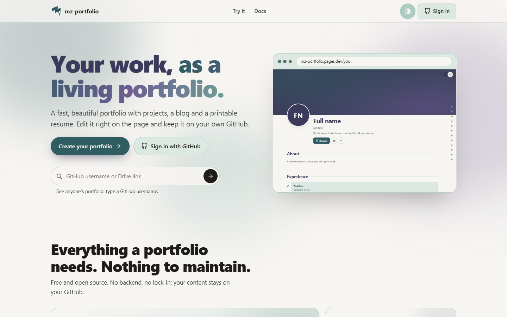
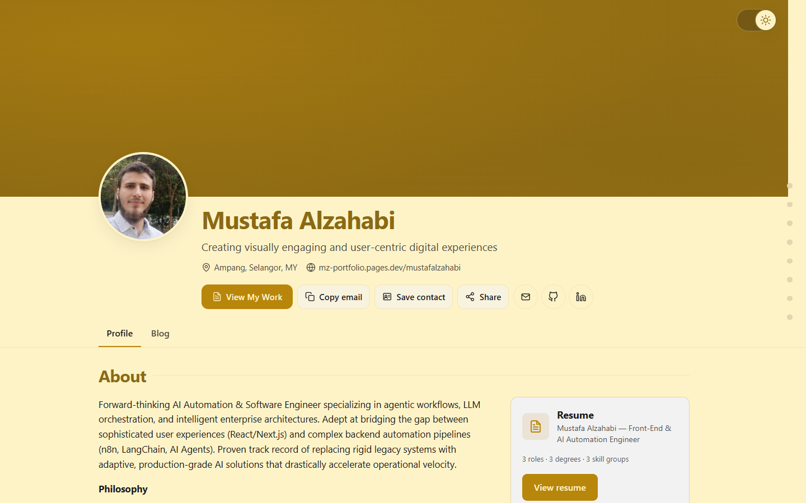
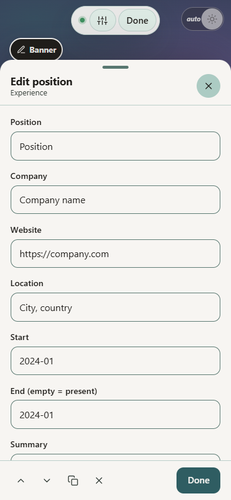

# mz-portfolio

A mobile-first portfolio with projects, a blog and a printable resume, edited right on the page and saved to your own GitHub. Rendered entirely in the browser. Pure HTML, CSS and JavaScript: no framework, no build step, no runtime dependencies.



## Screenshots

**A portfolio** (the built-in example). The photo overlaps the banner, with your details, actions and profile links beside it.



<p align="center"><strong>Editing in place, on a phone</strong><br></p>

## Features

- **Edit on the page.** Every part of the portfolio has an Edit button. Publishing saves to a gist on your GitHub (Google Drive works too).
- **Projects, merged.** Resume projects are matched with your GitHub repos, adding READMEs, languages and cover images. Each project has its own page.
- **Tabs.** Profile, Blog, and up to 8 custom tabs: links, embeds, Markdown, code files or sandboxed HTML demos.
- **Built-in resume viewer.** 8 print-ready themes (ports of JSON Resume themes), with print/PDF and download.
- **Blog.** Public gists with a `.md` file, or `.md` files in your Drive folder, become posts. Includes search, tags and pagination.
- **Colors.** The TwOP-Architecture color system: 10 tokens, with dark mode generated automatically.
- **Mobile first.** A bottom section bar on phones, side dots on desktop, and a 44px minimum touch target.
- **Customizable.** Colors, layout, sections, texts and animations, including a "dissolve" intro where each element condenses out of its own code.
- **Try it without an account.** Start from a blank page, or import a [JSON Resume](https://jsonresume.org/) file. Nothing is uploaded.
- **Production basics:**
  - Strict CSP and URL sanitising
  - A safe in-house Markdown renderer
  - Offline support (service worker plus saved snapshots)
  - Open Graph and JSON-LD metadata
  - Accessible landmarks and focus handling, with reduced motion respected

## URLs

| URL | Shows |
|---|---|
| `/` | Landing page |
| `/username` | GitHub user's portfolio (gist `resume.json` + repos) |
| `/gh/username` | Redirects to `/username` |
| `/<drive-file-or-folder-id>` | Google Drive portfolio |
| `/<id>/project/<slug>` | A project's own page |
| `/<id>/blog`, `/<id>/blog/<slug>` | Blog list and posts |
| `/<id>/tab/<slug>` | A custom tab |
| `/<id>/resume` | Profile with the resume viewer open |
| `/preview`, `/preview/view/...` | Try it: edit without an account, see an example, or import a JSON Resume |
| `/docs` | Guide and full settings reference |
| `/<id>#projects` | Scroll to a profile section |

**How the source is detected:**
- GitHub usernames are at most 39 characters of letters, digits and single hyphens.
- Drive IDs are usually 25–44 characters and often contain `_`.

So the id alone tells the sources apart, and you can also paste a full `drive.google.com/...` link. In the rare case an id could be either, GitHub is tried first, then Drive. `preview` and `docs` are reserved paths.

`?gistname=cv` loads `cv.json` instead of `resume.json`.

## Editing your portfolio

There's no separate editor: you edit your portfolio right on the page. Sign in with GitHub, open your own portfolio (or click *Edit my portfolio* in the account menu, or go to `/edit`), then click the pencil button. Edit mode is its own page: Back or *Done* leaves it.

Everything is edited where it's shown; there are no editing panels. Text is typed in place, other details sit in a small strip inside each item, and images change from the image itself:

- **Profile:** name, title, contact details, location, profile links, photo (your GitHub photo, an upload, a link, or none) and header options. **Banner:** gradient or image. The photo and banner choices change only the portfolio, never your resume's photo or your GitHub avatar.
- **Sections:** each title row has *Add*, move up/down and *Hide*. Empty sections can be added, and hidden ones shown again, at the bottom of the page.
- **Items:** every job, school, skill group, award, certificate, language and so on is edited in place, with move, duplicate and delete.
- **Pages:** the + at the end of the tabs adds a page (text, code, HTML demo, embedded site or link), edited on the page itself.
- **Projects** are edited on their own page: name, description, links, keywords, highlights and a cover image (upload or link). A repo that comes from GitHub can be added to your resume (then it's editable) or hidden.
- **Blog posts:** *New post* on the blog page, *Edit post* on each post. Posts publish on their own.
- **Resume:** the header button opens the resume viewer. Changing its theme in edit mode saves it to your portfolio; its content comes from your sections.
- **Site settings** (sliders icon in the top bar): opens over the page, grouped with a side menu: colors (dark-mode previews and a contrast report), section order, animations and every other setting from `/docs`, plus the raw JSON.
- **Undo / redo** (Ctrl+Z, Ctrl+Shift+Z), **Ctrl+S** to publish, **?** for shortcuts. The bottom bar shows what changed; click it for the details. Its ⋯ menu has *Save draft to GitHub*, *Discard changes* and *Copy / Download JSON*.

**Drafts.** Edits are a draft until you click **Publish**. The draft is kept in this browser automatically. **Save draft** also stores it on GitHub in a *secret* gist (`mz-portfolio-draft.json`) so you can continue on another device: the next time you open edit mode, you're offered the newest draft. Secret gists are unlisted (only reachable by their link) and never shown on your portfolio; the draft gist is deleted when you publish.

**Without an account,** `/edit` opens a preview with every section ready to fill in, editable the same way; copy or download the JSON when you're done, or sign in to publish it. Other people's portfolios never show edit controls.

**Signing in.** Click *Sign in*, then choose GitHub or Google. You can be signed in with both, and link them into one account (below).
- **GitHub** asks for the **gist** scope only. Your portfolio is a `resume.json` gist at `/your-username`. (A personal access token can still be pasted under *Use a personal access token instead*.)
- **Google** asks for access to the files this app creates in your Drive (`drive.file`) and its hidden app folder (`drive.appdata`), nothing else. Your portfolio is an *mz-portfolio* folder (shared as "anyone with the link can view") holding `resume.json`, posts and images, at `/<folder-id>`. The draft you save to your account goes to the hidden app folder, never the shared one. Google's sign-in lasts about an hour; after that you're asked to sign in again to save.
- **One account from both.** In *Account settings* (avatar menu), connect the other provider, or accept the offer shown when you're signed in with both. Signing in to both is the proof; a matching email alone never links accounts. The link is saved privately in both: a secret gist and Drive's hidden app folder (`mz-portfolio-account.json`), so either sign-in, on any device, opens the same account. There's no server database.
  - Your portfolio then combines both: each resume section comes from whichever was saved last (or the one you pick per section in *Account settings → Sources*), posts come from both (the same post in both shows its newer copy), and publishing writes to both by default. Both addresses (`/username` and `/<folder-id>`) show the same portfolio: the published config lists the two addresses (never your email) so visitors' browsers load and combine them.
  - Google's sign-in lasts an hour. Publishing to Drive renews it first in a small window that closes itself; if Google needs you, it says so and you reconnect in one click. A place you aren't signed in to on a device is skipped and catches up on the next publish.
  - *Account settings* also has where new posts and images go, README push permission, drafts, downloading your resume, and *Forget this device*.
- The token is kept in this browser's `localStorage` until you click *Sign out*, or until it expires or is rejected, so reopening the editor keeps you signed in. Sign out on shared computers.
- It is sent only to `api.github.com` (GitHub) or `www.googleapis.com` (Google), and never logged or written anywhere else.

**Setting up "Sign in with GitHub"** (once per deployment). GitHub needs a secret to finish a login, and its token endpoint can't be called from a page. So one small, stateless Cloudflare Pages Function in `functions/api/auth/` does that single step; there's no database and nothing is stored.
1. On GitHub, open *Settings → Developer settings → OAuth Apps → New OAuth App*. Set *Homepage URL* to your site and *Authorization callback URL* to `https://<your-domain>/api/auth/callback`.
2. Generate a client secret.
3. In Cloudflare Pages, open *Settings → Variables and secrets* and add `GITHUB_CLIENT_ID` and `GITHUB_CLIENT_SECRET` (encrypted) for Production. Then redeploy.

Add one redirect URI per domain you use (production, staging; an OAuth App allows up to 10) and set the variables in both the Production and Preview environments. Until the variables exist, the button explains that sign-in isn't set up and the token option still works. `node tools/dev-server.mjs` doesn't run Functions; use `npx wrangler pages dev public` to test sign-in locally.
- Publishing updates your `resume.json` gist, or creates one if you don't have it yet. Empty fields and blank items are dropped before saving. If the gist changed on GitHub since you opened it, you choose: overwrite it, load the GitHub version, or cancel.
- After publishing, the cached copy is cleared, so visitors see the change right away.

There is no sample data anywhere: a new portfolio shows each field's placeholder ("Full name", "Job title", …).

## Tabs

Profile is always the first tab. Blog appears when you have posts. You can add up to 8 tabs of your own in `meta["mz-portfolio-config"].tabs`:

```json
"tabs": [
  { "label": "Talks", "type": "embed", "url": "https://www.youtube.com/embed/VIDEO_ID" },
  { "label": "Notes", "type": "markdown", "url": "https://gist.githubusercontent.com/you/ID/raw/notes.md" },
  { "label": "Snippet", "type": "code", "language": "js", "content": "export const x = 1;" },
  { "label": "Demo", "type": "html", "height": 400, "url": "https://raw.githubusercontent.com/you/repo/main/demo.html" },
  { "label": "Website", "type": "link", "url": "https://example.com" }
]
```

| Type | What it does | Safety |
|---|---|---|
| `link` | Opens the URL in a new browser tab | https only |
| `embed` | Shows another site in a frame | https only, never this site's own pages; the frame can't navigate the portfolio |
| `markdown` | Renders Markdown | The safe built-in renderer; no raw scripts or unsafe links |
| `code` | Shows a code file with highlighting | Displayed as text, never run |
| `html` | Runs a small HTML/CSS/JS demo | Runs in `markup/sandbox.html` inside a sandboxed frame with an opaque origin, so it can't read the portfolio's page, storage or cookies |

Files can come from `content` (inline text) or a `url` on `raw.githubusercontent.com` or `gist.githubusercontent.com`.

## Configuration

Everything is configured inside your own `resume.json`. There is no separate config file.

```json
{
  "meta": {
    "theme": "elegant",
    "mz-portfolio-config": {
      "colors": { "accent": "#2f5d62" },
      "theme": { "mode": "auto", "toggle": "switch" },
      "sections": { "order": ["about", "projects", "work"], "hide": ["references"] },
      "projects": { "layout": "grid", "sort": "stars", "github": "matched" },
      "skills": { "display": "progress" },
      "animation": { "intro": "code" }
    }
  }
}
```

`/docs` lists every option, its type, its default and what it does. That page is generated from the schema in `public/scripts/config.js`. Older config shapes still work: top-level `accent`, `theme.accent`, `themeToggle.style`, `blog: false` and `animation.type`.

Animation intros:
- `none`
- `fade`
- `slide`
- `stagger`
- `typewriter`
- `blueprint`
- `code`: types out each section's builder function (or its HTML with `animation.code.source: "html"`), then reveals the section. Click or press Esc to skip.

### Resume themes (`meta.theme`)

These themes are rendered natively from ports of the original packages: `even` (default), `elegant`, `flat`, `kendall`, `stackoverflow`, `macchiato`, `onepage` and `professional`.

For any other theme name, the viewer asks the JSON Resume registry. If that fails, it shows `even` with a notice.

## Colors

`public/styles/style.css` follows TwOP-Architecture (`public/vanilla/styles/style.css`). There are ten light-mode inputs:

| Token | Role |
|---|---|
| `--base` | Canvas |
| `--core` | Text |
| `--accent` | Actions |
| `--variant` | Hover/focus |
| `--surface` | Cards |
| `--depth` | Borders |
| `--optimal` | Success |
| `--risky` | Warning |
| `--fatal` | Error |
| `--prime` | Brand |

**How dark mode is generated:**
- The `--color-*` outputs pass each token through TwOP's `--dm-*` formulas (oklch lightness inversion and chroma scaling).
- The formulas are written inline as relative colors, so they work in every current browser.
- Every other shade is a `color-mix()` of these outputs. The only exception is tags naming a programming language, which use GitHub's language colors (from linguist; turn off with `tags.languageColors: false`).

## Google Drive setup (site owner)

Browsers can't download Drive files directly, so Drive portfolios use the Drive API with a browser key:

1. In Google Cloud Console, enable the **Google Drive API** and create an **API key**.
2. Restrict the key:
   - **HTTP referrers:** your domain only.
   - **API restrictions:** Drive API only.
3. Set it as the `GOOGLE_API_KEY` variable in Cloudflare Pages (see below).

Users then share their `resume.json` file, or a folder containing it, as **Anyone with the link** and open `/<file-or-folder-id>`.

**"Sign in with Google"** (to create and edit Drive portfolios on the site). Google's browser sign-in needs no secret and no server code, only a client ID:
1. In the same Google Cloud project, configure the **OAuth consent screen** and add the scopes `.../auth/drive.file` and `.../auth/drive.appdata` (both non-sensitive).
2. Create an **OAuth client ID** of type *Web application*. Under *Authorized JavaScript origins* and *Authorized redirect URIs*, add each site root you use, e.g. `https://your-domain` and `https://your-domain/` (production, staging, and `http://localhost:8000` for development).
3. Set it as the `GOOGLE_CLIENT_ID` variable in Cloudflare Pages.

**Where the two values live.** Neither is a secret (both end up in the page), but they aren't committed: `functions/_middleware.js` fills them into the page's `<meta name="mz-google-api-key">` and `<meta name="mz-google-client-id">` from the Pages variables when it's served (`public/_routes.json` keeps static files from running it). Set them for both environments, e.g. `npx wrangler pages secret put GOOGLE_API_KEY --project-name mz-portfolio` (add `--env preview` for staging), or in *Settings → Variables and secrets*. Locally, put `GOOGLE_API_KEY=…` and `GOOGLE_CLIENT_ID=…` in a `.dev.vars` file (git-ignored); `node tools/dev-server.mjs` and `wrangler pages dev` both read it.

Without the client ID, only GitHub is offered. The API key above is needed too: visitors read Drive portfolios with it.

## GitHub rate limits

Unauthenticated visitors get 60 GitHub API calls per hour.
- A cold visit uses about 3: user, repos and gist list.
- Gists and READMEs come from raw hosts, which aren't limited.
- Responses are revalidated with ETags.
- Each portfolio is snapshotted for 30 minutes.
- If the limit is hit, a saved copy is shown with a banner, or a countdown page if nothing is saved.

## Development

```bash
node tools/dev-server.mjs        # http://localhost:8000 — serves public/ like Cloudflare Pages
node --test                      # unit tests + static checks (Node 20.11+, no dependencies)
node tools/check.mjs             # static checks only
```

Cloudflare Pages serves `public/index.html` for every route that isn't a file (SPA fallback), so path URLs like `/username/project/x` just work. `wrangler.toml` sets the Pages output directory to `./public`. The dev server does the same locally. Other static servers have no fallback; use `?p=username` there. Assets are linked with absolute paths (`/styles/…`), so the site must be served from the domain root.

## Project structure

The layout follows the [TwOP Architecture](https://github.com/hamuda8/TwOP-Architecture) vanilla template. There is no private origin (backend): everything is the static public origin.

```
public/                       Static public origin (Cloudflare Pages output)
├── index.html                Entry page (served for every route)
├── manifest.json
├── sw.js                     Service worker
├── markup/                   Other HTML: error.html, sandbox.html (isolated demo runner)
├── scripts/
│   ├── index.js              Entry: PortfolioCore class → window.App
│   ├── app.js  router.js  config.js  data.js  api.js  merge.js
│   ├── components.js  theme.js  icons.js  languages.js  markdown.js  utils.js  log.js
│   ├── template.js           Resume field specs + placeholder template
│   ├── editor-core.js        Editor logic without the DOM (undo, diff, validation)
│   ├── github.js             Gist API for the editor
│   ├── views/                landing · docs · preview (Try it) · site-header · status
│   ├── edit/                 mode.js (editing on the page) · core.js (draft, forms, saving)
│   ├── animations/           index · code-reveal
│   └── resume/               index · helpers · themes/*.js
├── styles/
│   ├── style.css             TwOP color scheme; imports the parts below
│   └── global · header · navbar · sections · projects · detail · project-page
│       blog · home · status · animations · resume-overlay (.css)
└── assets/
    ├── images/               logo.svg (logo + favicon) …
tests/                        node --test (fixtures/resume.json is test-only data)
tools/dev-server.mjs          Local server with the same SPA fallback as Cloudflare
tools/check.mjs               Static checks: imports, CSP-safe HTML, no stray colors, @imports
.github/workflows/test.yml    Runs the tests on every push and PR
wrangler.toml                 Pages settings (output dir: ./public)
```

The unfinished AI assistant lives in `experimental/`, outside `public/`, so it is not deployed.

**TwOP's "no logic bleed" rule:** TwOP says secrets never go in `public/`. The only key here is the optional Google Drive browser key, which is public by design and must be locked to your domain (see above). Anything truly secret would need a private origin.

## License

Personal portfolio engine. Feel free to fork, customize and deploy.
